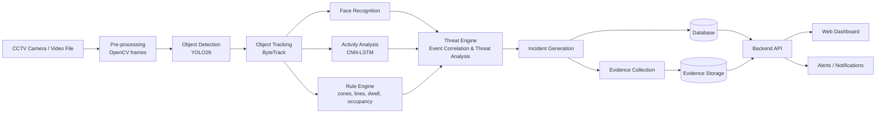
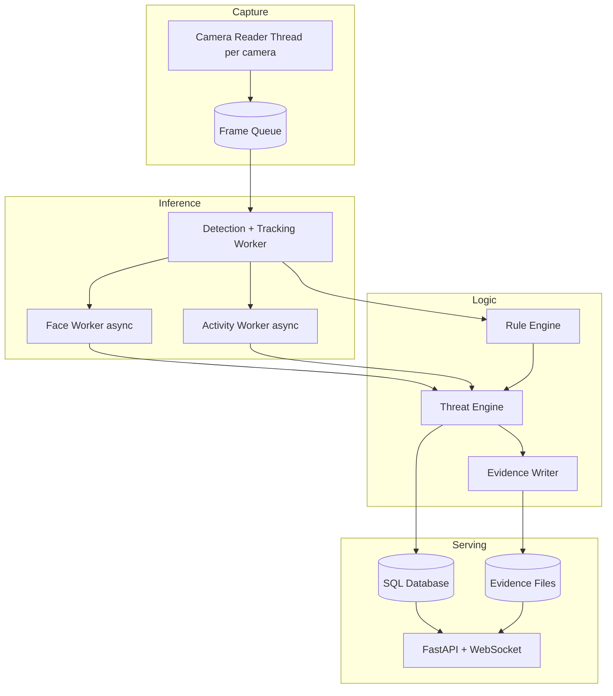
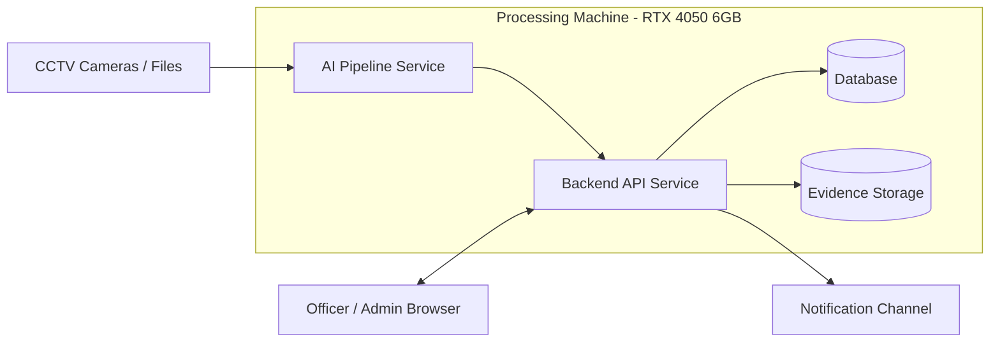

# 03 — System Architecture

**Project:** An Intelligent CCTV Surveillance System Using YOLO, ByteTrack, CNN-LSTM and Face Recognition for Automated Threat Detection

## 1. Architectural Overview

The system is a pipeline of intelligent modules. Video enters on the left and a stored, evidence-backed incident leaves on the right, shown on the web dashboard. Each stage passes its output to the next.

```
CCTV Camera Input → Pre-processing → Object Detection → Object Tracking
        → Face Recognition → Activity Analysis
        → Event Correlation & Threat Analysis → Incident Generation
        → Data Storage → Alerts and Web Dashboard
```

## 2. High-Level Diagram



## 3. The Four Functional Modules

### Module A — Intelligent Video Surveillance
- Reads live or recorded video frame by frame using OpenCV.
- Converts frames into the format needed by the models.
- YOLO26 detects people, vehicles, luggage.
- Records object type, bounding box coordinates and confidence score.
- Output: raw detections, the basic information for later stages.

### Module B — Person Identification and Tracking
- ByteTrack assigns an ID as soon as a person is detected and keeps it in following frames.
- Detection triggers face recognition to decide Known or Unknown.
- A recognised identity is attached to the person's Track ID.
- Output: tracked objects with identity.

### Module C — Security Event Intelligence
- CNN-LSTM analyses frame sequences to determine actions.
- Security rules determine restricted-area entry, staying in position, line crossing, leaving an object.
- Threat engine combines Track ID, identity, activity type, time, location and event, links events in a time window, and assigns threat level and score.
- Output: correlated incidents.

### Module D — Incident Response and Evidence Management
- Stores incident data in the database.
- Authorised users search incidents by keyword on the web.
- Sends notifications to security staff so they can analyse and act.
- Output: stored incidents, evidence, alerts.

## 4. Component Responsibilities

| Component | Responsibility | Inputs | Outputs |
|-----------|----------------|--------|---------|
| Video Acquisition | Read stream, produce frames | RTSP/file/webcam | Frames |
| Pre-processor | Resize, normalise, timestamp | Frames | Model-ready frames |
| Detector | Find objects | Frames | Detections |
| Tracker | Maintain IDs, build paths | Detections | Tracks |
| Face Recogniser | Match faces to known DB | Person crops | Identity per track |
| Activity Analyser | Classify behaviour from 16-frame windows | Track crops/windows | Activity label + confidence |
| Rule Engine | Zone, line, dwell, occupancy, abandoned-object logic | Tracks + zones | Events |
| Threat Engine | Correlate events, score, create incidents | Events | Incidents |
| Evidence Collector | Save images and clip | Frames buffer + incident | Evidence files |
| Storage | Persist data | Incidents, events, evidence refs | Database rows, files |
| API Server | Serve data and push live updates | DB, live state | REST/WebSocket |
| Dashboard | Present to operators | API | UI |
| Notifier | Send alerts | New high-severity incidents | Messages |

## 5. Runtime Architecture



Design notes:
- One reader thread per camera; bounded queues drop the oldest frame to stay real-time.
- Face and activity workers run asynchronously so they never block detection and tracking.
- A rolling frame buffer keeps the last seconds of video so a clip can be saved around an incident.

## 6. Deployment View



For version 1, all services run on a single machine. Services are separate processes so they can later be split across machines or moved to edge devices.

## 7. Architectural Principles

1. **Pretrained first:** only the activity head is trained.
2. **Evidence-based:** every incident carries verifiable images and video.
3. **Correlate, do not spam:** related events become one incident.
4. **Modular:** each stage has a clear input/output so a model can be replaced independently.
5. **Configurable:** zones, limits and thresholds come from configuration.
6. **Resilient:** one failing camera does not stop the system.
