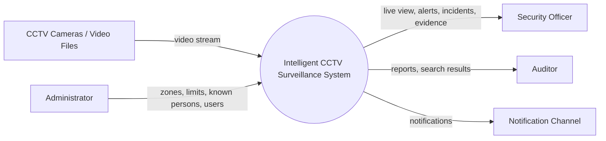
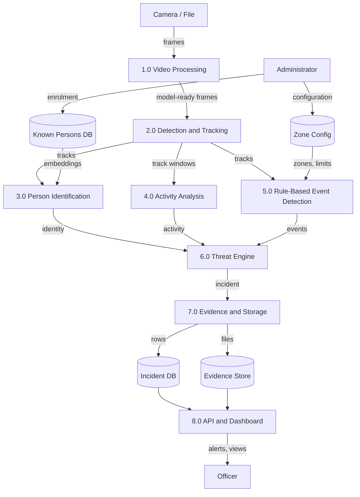
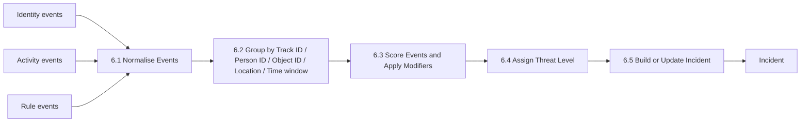
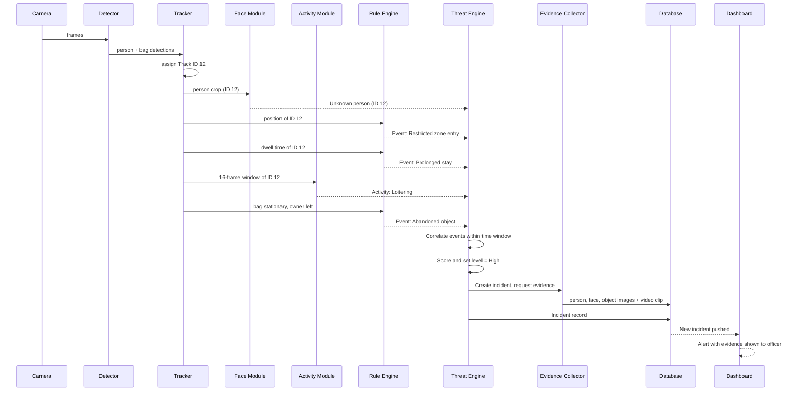

# 04 — Data Flow

**Project:** An Intelligent CCTV Surveillance System Using YOLO, ByteTrack, CNN-LSTM and Face Recognition for Automated Threat Detection

## 1. End-to-End Data Flow

| Step | Stage | Input | Processing | Output |
|------|-------|-------|------------|--------|
| 1 | Video acquisition | Live stream or video file | Read and split into frames | Raw frames with camera ID + timestamp |
| 2 | Pre-processing | Raw frames | Resize (640 px for models), normalise | Model-ready frames |
| 3 | Object detection | Frames | YOLO26 inference | Detections: class, bbox, confidence |
| 4 | Object tracking | Detections | ByteTrack association | Tracks: Track ID, bbox, path, time in zone |
| 5 | Person identification | Person crops | Face detect, embed, match to known DB | Known (name/ID) or Unknown per Track ID |
| 6 | Activity analysis | 16-frame window per track | CNN features + LSTM | Activity label (fighting, running, loitering…) + confidence |
| 7 | Security event detection | Tracks + zones + identity + activity | Rule evaluation | Events: type, time, location, severity |
| 8 | Event correlation | Events | Group by Track ID, person ID, object ID, location, time window | Correlated event group |
| 9 | Threat analysis | Event group | Weighted scoring | Threat level and threat score |
| 10 | Incident generation | Scored group | Build record | Incident with number, subject, status, place, time, activities, level, score |
| 11 | Evidence collection | Incident + frame buffer | Crop images, cut video clip | Person image, face image, object image, clip |
| 12 | Storage | Incident + evidence refs | Insert rows, write files | Persisted incident |
| 13 | Alert and dashboard | Stored incident + live state | Push through WebSocket / notifier | Operator sees alert with evidence |

## 2. Context Diagram (DFD Level 0)

## 3. DFD Level 1

## 4. DFD Level 2 — Threat Engine (Process 6.0)

## 5. Sequence: One Incident from Start to Finish

Scenario: an unknown person enters a closed server room, stays, leaves a bag, and walks out.

## 6. Data Objects

### Detection
`{camera_id, frame_id, timestamp, class, bbox[x1,y1,x2,y2], confidence}`

### Track
`{camera_id, track_id, class, bbox, path[], first_seen, last_seen, zone_ids[], dwell_seconds}`

### Identity
`{track_id, status: known|unknown, person_id|null, match_score}`

### Activity
`{track_id, label, confidence, window_start, window_end}`

### Event
`{event_id, camera_id, track_id, person_id|null, object_id|null, event_type, timestamp, location, severity, details}`

### Incident
`{incident_no, camera_id, subject_refs[], status, place, start_time, end_time, activities[], threat_level, threat_score, event_ids[], evidence_ids[]}`

### Evidence
`{evidence_id, incident_no, type: person_image|face_image|object_image|video_clip, path, timestamp, location}`

## 7. Data Stores

| Store | Contents |
|-------|----------|
| Known Persons DB | Person ID, name, face embeddings, enrolment images |
| Zone Config | Zone polygons, line coordinates, occupancy limits, thresholds |
| Incident DB | Cameras, tracks summary, events, incidents, evidence references, users |
| Evidence Store | Image and video files organised by incident number |
| Runtime memory | Frame buffer, active tracks, live metrics (not persisted) |

## 8. Live Data to Dashboard

| Message | Trigger | Content |
|---------|---------|---------|
| `camera_status` | Periodic | Camera ID, FPS, processing ms, people count, alert state |
| `detections` | Each processed frame (throttled) | Boxes, confidence, Track IDs, identity |
| `incident_created` | New incident | Incident summary and evidence links |
| `incident_updated` | Level/status/event change | Updated fields |
