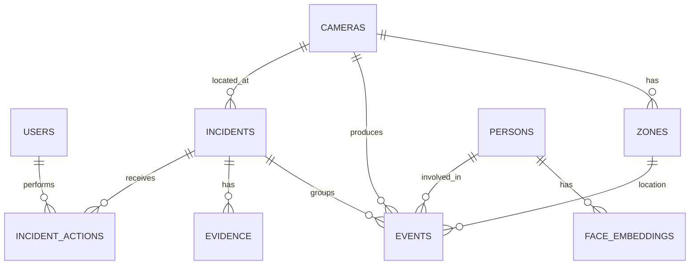

# 07 — Database Schema

**Project:** An Intelligent CCTV Surveillance System Using YOLO, ByteTrack, CNN-LSTM and Face Recognition for Automated Threat Detection
**Database:** SQLite (development), PostgreSQL (deployment)

## 1. Entity Relationship Diagram



## 2. Tables

### users
| Column | Type | Notes |
|--------|------|-------|
| id | INTEGER PK | |
| username | TEXT UNIQUE | |
| password_hash | TEXT | Hashed, never plain |
| role | TEXT | admin / officer / auditor |
| created_at | DATETIME | |

### cameras
| Column | Type | Notes |
|--------|------|-------|
| id | TEXT PK | e.g. CAM02, CAM03 |
| name | TEXT | e.g. Main entrance, Warehouse aisle |
| source_url | TEXT | RTSP URL, device index or file path |
| location | TEXT | Place description |
| status | TEXT | online / offline |
| occupancy_limit | INTEGER | Optional, example 4 |
| created_at | DATETIME | |

### zones
| Column | Type | Notes |
|--------|------|-------|
| id | INTEGER PK | |
| camera_id | TEXT FK | |
| name | TEXT | |
| type | TEXT | restricted / line / occupancy / watch |
| geometry | JSON | Polygon points or line endpoints |
| direction | TEXT | For lines: forbidden crossing direction |
| dwell_threshold_s | INTEGER | Prolonged stay threshold |
| high_risk | BOOLEAN | Used by threat modifier |

### persons
| Column | Type | Notes |
|--------|------|-------|
| id | INTEGER PK | |
| name | TEXT | |
| category | TEXT | staff / visitor / watchlist |
| authorised_zone_ids | JSON | Zones where presence is allowed |
| created_at | DATETIME | |

### face_embeddings
| Column | Type | Notes |
|--------|------|-------|
| id | INTEGER PK | |
| person_id | INTEGER FK | |
| embedding | BLOB | Vector from ArcFace |
| image_path | TEXT | Enrolment image |

### events
| Column | Type | Notes |
|--------|------|-------|
| id | INTEGER PK | |
| incident_id | INTEGER FK NULL | Set when grouped |
| camera_id | TEXT FK | |
| zone_id | INTEGER FK NULL | |
| track_id | INTEGER | |
| person_id | INTEGER FK NULL | Null for unknown |
| object_id | INTEGER NULL | Track ID of related object |
| event_type | TEXT | See threat engine spec |
| severity | TEXT | low / medium / high |
| confidence | REAL | |
| timestamp | DATETIME | |
| location | JSON | Coordinates and zone name |
| details | JSON | Extra data |

### incidents
| Column | Type | Notes |
|--------|------|-------|
| id | INTEGER PK | |
| incident_no | TEXT UNIQUE | e.g. INC-000045 |
| camera_id | TEXT FK | |
| place | TEXT | Camera and zone |
| subject | JSON | Person / object references |
| status | TEXT | new / acknowledged / resolved / false_alarm |
| activities | JSON | List of suspicious activities |
| threat_level | TEXT | low / medium / high / critical |
| threat_score | INTEGER | 0–100 |
| start_time | DATETIME | |
| last_event_time | DATETIME | |
| closed_at | DATETIME NULL | |
| model_versions | JSON | Models used |
| keywords | TEXT | Searchable text |

### evidence
| Column | Type | Notes |
|--------|------|-------|
| id | INTEGER PK | |
| incident_id | INTEGER FK | |
| type | TEXT | person_image / face_image / object_image / video_clip |
| file_path | TEXT | Relative path |
| timestamp | DATETIME | |
| location | JSON | |

### incident_actions
| Column | Type | Notes |
|--------|------|-------|
| id | INTEGER PK | |
| incident_id | INTEGER FK | |
| user_id | INTEGER FK | |
| action | TEXT | acknowledged / resolved / false_alarm / note |
| note | TEXT | |
| created_at | DATETIME | |

### camera_metrics
| Column | Type | Notes |
|--------|------|-------|
| id | INTEGER PK | |
| camera_id | TEXT FK | |
| timestamp | DATETIME | |
| people_count | INTEGER | |
| fps | REAL | |
| processing_ms | REAL | |
| alert_state | TEXT | e.g. None, Restricted presence (High), Occupancy limit (Medium) |

## 3. Indexes

- `incidents(incident_no)`, `incidents(threat_level, start_time)`, `incidents(camera_id, start_time)`
- `events(incident_id)`, `events(camera_id, timestamp)`, `events(track_id)`
- `evidence(incident_id)`
- Full-text index on `incidents.keywords` for keyword search

## 4. Evidence Storage Layout

```
evidence/
└── INC-000045/
    ├── person_01.jpg
    ├── face_01.jpg
    ├── object_01.jpg
    └── clip.mp4
```

The database stores relative paths only.

## 5. Retention

- Incidents and evidence kept for a configurable period (default 90 days).
- Non-incident video is not stored.
- Metrics older than 30 days are aggregated or removed.
